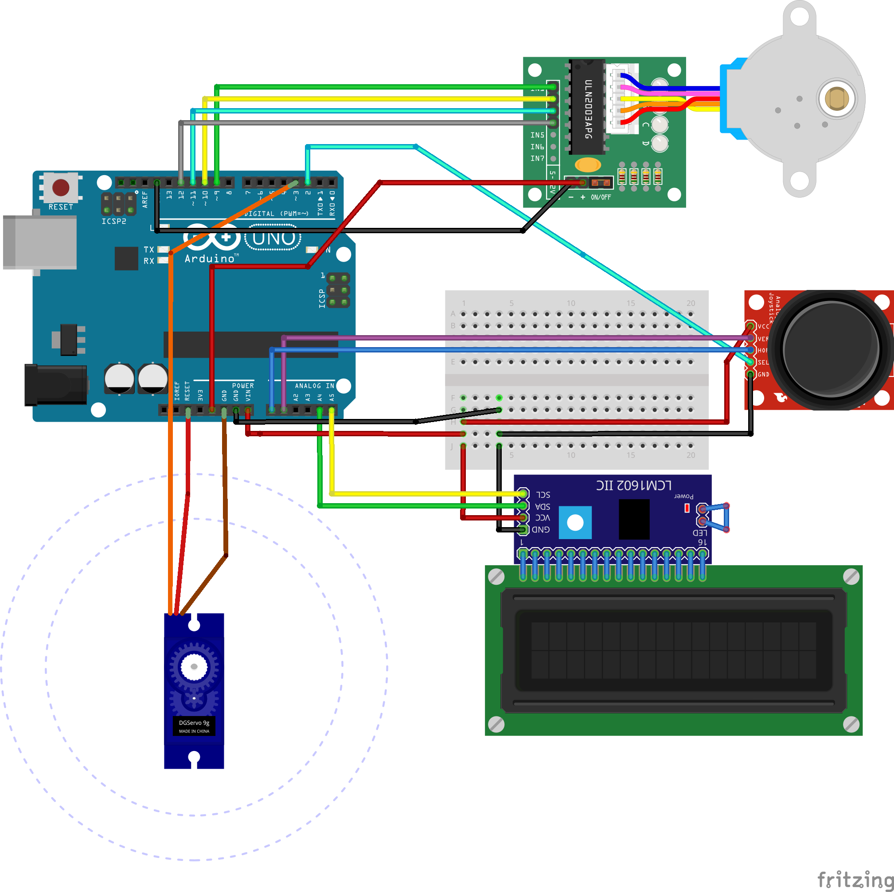

# 3d-scanner

Turnable platform for taking photos. Suited for photogrammetry.

This project is based on [3d scanner by Bribro12](https://www.thingiverse.com/thing:3958326).

## What is different

The program from the original author was a little confusing, so I wrote my own. I also added an I2C adapter for an LCD screen.

**TODO:** Update the enclosure to add a dedicated space for the I2C adapter and a snappable screen cover.

**Update 09.03.2024:** I looked into controlling the camera with an earphone cable instead of the servo — more convenient and easier to set up, and it would remove the servo from the build entirely. This isn't wired into the current sketch yet, though: `3d_scanner.ino` still triggers the shutter with the servo (see [How it works](#how-it-works-and-how-to-use) below); the jack-cable approach is a planned follow-up.

## Components

- Arduino UNO
- A jack cable from an earphone (planned — see the update above; not yet used by the current sketch)
- 240 ohm resistor
- Joystick module
- LCD screen
- I2C adapter for LCD screen
- Step motor
- Step motor driver
- Small breadboard
- Header cables
- 3D files: see [`3d Scanner.fzz`](<3d Scanner.fzz>) in this repo

## Schematics

TODO: Update the schematic with the jack cable wiring, once that's actually implemented.

If you couldn't configure the jack, [here is a good guide for it](https://vervainglobal.com/articles/remote-shutter.html).

## How it works and How to use

The platform does one complete turn. By dividing that turn into a number of steps, we get a portion per step. On each portion, the servo (`shutter()` in the sketch) is activated and presses the camera's shutter button before the platform steps to the next position.

The number of steps can be adjusted with the joystick, and the current value is shown on the LCD. After choosing the desired number and pressing the joystick button, the device starts scanning and begins slowly spinning through each step.

## Results

To do